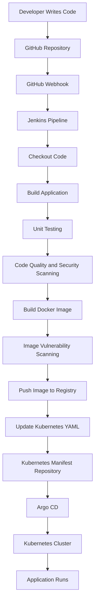

# Real-Time CI/CD Pipeline Using Jenkins, Docker, Kubernetes and Argo CD

## 1. Introduction

CI/CD is a process that automates how application code moves from a developer's machine to the production environment.

To understand CI/CD, let's imagine we are developing an online shopping application like Amazon.

We write application code on our laptop. But how does that application reach customers?

We cannot simply give our laptop to customers, right? We need to:

1. Store our application code.
2. Build the application.
3. Test the application.
4. Check code quality and security.
5. Package the application.
6. Deploy it to a server.
7. Make the application available to customers.

We automate these activities using CI/CD.

## 2. Understanding the Big Picture

Imagine this is our application delivery process:

| Tool / Component | Responsibility |
|---|---|
| Developer | Writes application code |
| GitHub | Stores application code |
| Jenkins | Builds, tests and packages the application |
| Docker | Packages the application into a container image |
| Docker Hub / Amazon ECR | Stores the container image |
| Argo CD | Synchronizes deployment configuration with Kubernetes |
| Kubernetes | Runs and manages the application |

This is the basic idea behind a real-time CI/CD pipeline.

Now let's understand each tool step by step.

## 3. GitHub – Where Do We Store Code?

GitHub is a platform used to store and manage source code.

Imagine we develop an application and push the code to GitHub.

GitHub stores our code so that developers and team members can access and manage it.

Example project structure:

```text
my-shopping-app/
├── index.html
├── app.py
├── requirements.txt
└── Dockerfile
```

**Remember:** GitHub stores the application code. It does not automatically perform all CI/CD activities by itself.

## 4. Webhook – How Does Jenkins Know About New Code?

Imagine we push new code to GitHub.

How will Jenkins know that we have pushed new code?

We configure something called a **GitHub Webhook**.

Think of a webhook like a notification.

The process works like this:

1. Developer pushes code to GitHub.
2. GitHub sends a notification to Jenkins.
3. Jenkins receives the notification.
4. Jenkins starts the pipeline.

**Remember:** A webhook sends a notification when a particular event occurs. In this example, the event is a code push.

## 5. Jenkins – The Manager

Jenkins is an automation server used to build and execute CI/CD pipelines.

Remember what we learned earlier?

Jenkins is an orchestrator.

Imagine Jenkins as a manager who coordinates different tools and tells them what tasks to perform.

For example:

| Jenkins asks | Tool | Work performed |
|---|---|---|
| Build the Java application | Maven | Builds the application |
| Test the application | JUnit | Runs unit tests |
| Check code quality | SonarQube | Analyzes source code |
| Create a container image | Docker | Builds the image |

Jenkins coordinates these activities and manages the pipeline execution.

### 5.1 What Are Jenkins Stages?

Inside Jenkins, we define different stages to organize the pipeline.

Example:

```text
Jenkins Pipeline
       |
       v
    Checkout
       |
       v
   Build & Test
       |
       v
  Code Scanning
       |
       v
   Image Build
       |
       v
  Image Scanning
       |
       v
   Image Push
```

Let's understand each stage.

**1. Checkout**

Jenkins downloads the application source code from the GitHub repository.

**2. Build**

The application is built using a build tool such as Maven.

**3. Unit Testing**

The application is tested to check whether individual functions and components work correctly.

For Java applications, we can use JUnit.

**4. Static Code Analysis**

The source code is analyzed to identify code quality issues such as bugs and code smells.

We can use SonarQube and other code analysis tools.

**5. Security Scanning**

The source code is checked for potential security vulnerabilities.

SonarQube and other security scanning solutions can be integrated into this process.

**6. Image Build**

Docker builds a container image using the application's Dockerfile.

**7. Image Scanning**

The Docker image is scanned for vulnerabilities in its base image, operating system packages and application dependencies.

**8. Image Push**

The Docker image is uploaded to a container registry such as Docker Hub or Amazon ECR.

At this point, Jenkins has completed the main CI activities in this example.

### 5.2 What Is a Jenkinsfile?

A Jenkinsfile is a file used to define the Jenkins pipeline.

It contains the stages and steps that Jenkins needs to execute.

Jenkins supports two pipeline styles:

1. Declarative Pipeline
2. Scripted Pipeline

In this lesson, we focus on the **Declarative Pipeline**.

It provides a structured way to define pipeline stages and makes the pipeline easier to read and collaborate on.

A Jenkinsfile can define stages such as:

- Checkout
- Build
- Unit Testing
- Code Analysis
- Docker Image Build
- Image Scanning
- Push Image to Registry

## 6. Docker – Why Do We Need It?

Docker is a containerization platform.

Imagine we developed an application.

Our application needs Python, libraries and other dependencies to run.

Instead of installing everything separately on every server, we package the application and its dependencies into a container image.

That is what Docker helps us do.

Example command:

```bash
docker build -t shopping-app:v1 .
```

This creates a Docker image named `shopping-app` with version `v1`.

**Remember:** Docker packages the application into a container image.

## 7. Docker Hub / Amazon ECR – Where Do We Store the Image?

We have created a Docker image. Now we need to store it somewhere so that Kubernetes can download it.

That's why we use a container image registry.

Two commonly used registries are:

- **Docker Hub:** A platform for storing and sharing container images.
- **Amazon ECR:** AWS's managed container image registry.

Example:

```bash
docker push shopping-app:v1
```

This pushes the image to the configured registry, provided we have authenticated and tagged it with the correct registry name.

**Remember:**

- Docker creates the image.
- Docker Hub or Amazon ECR stores the image.
- Kubernetes can download the image from the registry.

## 8. Kubernetes – Where Does Our Application Run?

Kubernetes is a container orchestration platform used to manage and run containerized applications.

Now we have an application image stored in Docker Hub or Amazon ECR.

We want to run this application using Kubernetes.

But Kubernetes needs to know:

- Which image should I download?
- How many application copies should I run?
- Which container port should I use?

We provide this information using Kubernetes YAML manifest files.

### 8.1 Example Kubernetes Deployment YAML

```yaml
apiVersion: apps/v1
kind: Deployment

metadata:
  name: shopping-app

spec:
  replicas: 2

  selector:
    matchLabels:
      app: shopping-app

  template:
    metadata:
      labels:
        app: shopping-app

    spec:
      containers:
        - name: shopping-app
          image: shopping-app:v1
          ports:
            - containerPort: 5000
```

### Understanding the YAML

- `kind: Deployment` – Defines a Kubernetes Deployment.
- `name: shopping-app` – Name of the Deployment.
- `replicas: 2` – Requests two application Pods.
- `image: shopping-app:v1` – Specifies the container image to run.
- `containerPort: 5000` – Specifies the application's container port.

Kubernetes uses this configuration to create and manage the application Pods.

But now comes an important question.

**Who updates this YAML file whenever we create a new Docker image?**

That's where Argo CD comes in.

## 9. Argo CD – How Does the New Application Reach Kubernetes?

Argo CD is a GitOps continuous delivery tool used to manage application deployments on Kubernetes.

Imagine today we created:

```text
shopping-app:v1
```

Tomorrow, the developer makes changes and Jenkins creates:

```text
shopping-app:v2
```

Now we need to update the Kubernetes YAML file with the new image version.

Old version:

```yaml
image: shopping-app:v1
```

New version:

```yaml
image: shopping-app:v2
```

We push this updated YAML file to GitHub.

Argo CD continuously watches the Git repository containing the Kubernetes manifest files.

When it detects the new configuration, it synchronizes the Kubernetes cluster with the desired configuration.

Kubernetes then pulls the updated image from the registry and runs the new application version.

### Remember:

- Jenkins builds the new Docker image.
- The image registry stores the image.
- GitHub stores the updated Kubernetes YAML.
- Argo CD detects the configuration changes and synchronizes them.
- Kubernetes runs the updated application.

## 10. What Is GitOps?

GitOps is an approach where Git acts as the **single source of truth** for deployment configurations.

In simple words, the configuration stored in Git represents how we want our Kubernetes cluster to look.

Imagine your Kubernetes YAML says:

```yaml
replicas: 3
```

This means we want three application Pods.

But someone manually changes the Kubernetes cluster to run only two replicas.

Now the actual cluster state does not match the desired configuration stored in Git.

Argo CD can detect this difference and reconcile the cluster towards the desired state.

This process is called **Continuous Reconciliation**.

In simple words, Argo CD continuously checks whether Kubernetes matches the configuration stored in Git.

## 11. Alternative Deployment Without Argo CD

Argo CD is not the only way to deploy applications to Kubernetes.

We can also deploy applications directly through Jenkins.

In this approach, Jenkins can use:

- Shell scripts
- Python scripts
- Ansible
- kubectl
- Helm

These tools can be used to apply Kubernetes manifests or update Helm releases.

Ansible can also be useful when managing deployments across multiple Kubernetes clusters.

### Difference Between Both Approaches

**With Argo CD:**

Jenkins builds and pushes the image. The Kubernetes manifest repository is updated, and Argo CD synchronizes the changes with Kubernetes.

**Without Argo CD:**

Jenkins can directly execute deployment commands using tools such as kubectl, Helm or Ansible.

## 12. Complete Real-Time CI/CD Pipeline

Now let's connect everything using our online shopping application example.

### Complete Workflow

1. **Developer:** Writes application code and pushes it to GitHub.
2. **GitHub Webhook:** Notifies Jenkins about new code changes.
3. **Jenkins:** Checks out code, builds the application, runs tests and performs code analysis and security scanning.
4. **Docker:** Creates the container image.
5. **Image Scanning:** Checks the container image for vulnerabilities.
6. **Image Registry:** Stores the Docker image.
7. **Kubernetes Manifest Repository:** Stores the updated YAML with the new image version.
8. **Argo CD:** Detects the updated YAML and synchronizes the configuration with Kubernetes.
9. **Kubernetes:** Pulls the new image and runs the updated application.

### Complete CI/CD Flow Diagram



## 13. Jenkins vs Argo CD

Both tools are used in the CI/CD process, but they have different responsibilities.

| Jenkins | Argo CD |
|---|---|
| Automates the CI pipeline | Automates GitOps-based delivery |
| Checks out source code | Monitors the Kubernetes manifest repository |
| Builds the application | Synchronizes configuration |
| Executes unit tests | Helps maintain the desired cluster state |
| Builds Docker images | Applies desired configuration to Kubernetes |
| Pushes images to registries | Deploys updated configurations through GitOps |

**Important difference:**

Jenkins builds and pushes the Docker image. Argo CD monitors the Git repository containing Kubernetes configurations and synchronizes those configurations with the cluster.

## 14. Real-Time CI/CD Interview Explanation

If an interviewer asks how a real-time CI/CD pipeline works, I can explain it like this:

"In a typical CI/CD workflow, developers write application code and push it to a Git repository such as GitHub. When new code is pushed, a webhook triggers the Jenkins pipeline.

Jenkins checks out the latest source code and performs the build, unit testing, static code analysis and security scanning stages.

After the application passes the required checks, Jenkins builds a Docker image, scans it for vulnerabilities and pushes it to a container registry such as Docker Hub or Amazon ECR.

Next, the Kubernetes manifest repository is updated with the new Docker image tag.

Argo CD monitors this Git repository and detects configuration changes. It then synchronizes the updated configuration with the Kubernetes cluster.

Finally, Kubernetes pulls the new Docker image and runs the updated application.

This process helps automate application delivery and reduces manual deployment work."

## 15. Key Takeaways

- **GitHub:** Stores and manages application source code.
- **Webhook:** Notifies Jenkins when new code is pushed.
- **Jenkins:** Orchestrates and executes the CI pipeline.
- **Maven:** Builds Java applications.
- **JUnit:** Executes unit tests.
- **SonarQube:** Analyzes code quality and potential security issues.
- **Docker:** Packages applications into container images.
- **Image Scanning:** Identifies vulnerabilities in container images.
- **Docker Hub / Amazon ECR:** Stores container images.
- **Kubernetes:** Runs and manages containerized applications.
- **Kubernetes YAML:** Defines the desired application configuration.
- **Argo CD:** Synchronizes Git configuration with Kubernetes.
- **GitOps:** Uses Git as the single source of truth.

## Conclusion

In this lesson, I learned how different DevOps tools work together to create a real-time CI/CD pipeline.

I understood how application code moves from GitHub to Jenkins, how Docker images are built and stored in a registry, and how Argo CD helps deploy applications to Kubernetes using GitOps.

The main idea is to automate the complete application delivery process with minimal manual intervention.
